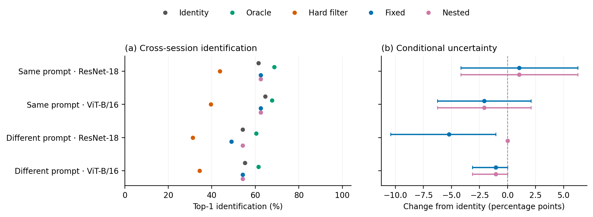
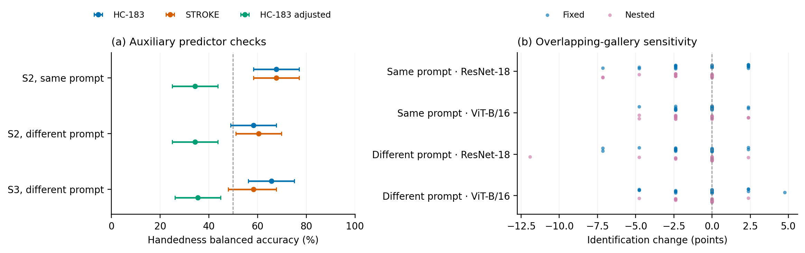

# CSAFE cross-session external replication

Completed from the original frozen design in protocol_v1.json and the numerical implementation amendment in protocol_v1_1.json. Dataset: [CSAFE Handwriting Database v2](https://doi.org/10.25380/iastate.10062203.v2), CC BY 4.0. The [original Data in Brief article](https://doi.org/10.1016/j.dib.2019.105059) describes an earlier 90-writer release; the version-2 survey contains 475 writers. Counts below come from the actual version-2 data, not extrapolation from that article.

## Design and scope

The cohort consists of all 48 left-handed participants and 48 seeded right-handed participants. Three ambidextrous participants and one missing-hand participant were excluded before sampling. All 864 selected pages passed the frozen feature-validity rules. Each participant supplies six long-text session-1 pages for auxiliary-model training, one of which (LND repetition 1) is the identity gallery reference. The other pages of a queried writer never enter its handedness fitting or calibration. Queries use separate physical pages from session 2 (same/different prompt) and session 3 (different prompt).

Reported timing is positive for all available query-to-gallery day differences: session 2 minus session 1 has 94 nonmissing values, median 33 days and range 18–252; session 3 minus session 1 has 95 nonmissing values, median 68 days and range 42–272. Missing timing entries are retained under their original session labels. The data do not support claiming that every observed gap is at least 21 days.

The same original descriptors, pretrained neural checkpoints, SVM C=0.1, logistic-calibration objective, temperature grid and fusion-weight grid were retained. Numerical convergence warnings in an initial sensitivity-model pass were resolved by centering/scaling training OOF SVM scores and transforming the L2 penalty algebraically to preserve the original C=10000 objective; every fit was rerun and checked by its analytic gradient. This amendment preceded inspection of CSAFE performance tables. There is no network fine-tuning or classifier selection based on achieved CSAFE accuracy. The primary handedness model is HC-183; STROKE and intensity-adjusted HC-183 are predefined sensitivity models. The protocol was specified before CSAFE outcomes, as an extension of the existing study; it is not a publicly registered preregistration.

This evaluates a new dataset, writer population, physical pages and acquisition sessions with within-dataset model refitting. It is not transfer of a frozen Bangla-trained predictor. The 20 balanced 42-writer galleries are overlapping subsamples from this same selected 96-writer pool, not independent dataset replications.

## Handedness prediction

| Query condition | Attribute model | Balanced accuracy (%) | Conditional 95% CI (%) | Raw / calibrated AUC | NLL / Brier |
|---|---|---:|---:|---:|---:|
| Session 2, same prompt | HC-183 | 67.71 | [58.33, 77.08] | 0.737 / 0.711 | 0.636 / 0.221 |
| Session 2, same prompt | STROKE | 67.71 | [58.33, 77.08] | 0.770 / 0.741 | 0.638 / 0.213 |
| Session 2, same prompt | HC-183 adjusted | 34.38 | [25.00, 43.75] | 0.727 / 0.501 | 0.686 / 0.245 |
| Session 2, different prompt | HC-183 | 58.33 | [48.96, 67.71] | 0.651 / 0.641 | 0.682 / 0.239 |
| Session 2, different prompt | STROKE | 60.42 | [51.04, 69.79] | 0.725 / 0.687 | 0.695 / 0.226 |
| Session 2, different prompt | HC-183 adjusted | 34.38 | [25.00, 43.75] | 0.692 / 0.495 | 0.675 / 0.241 |
| Session 3, different prompt | HC-183 | 65.62 | [56.25, 75.00] | 0.725 / 0.702 | 0.645 / 0.225 |
| Session 3, different prompt | STROKE | 58.33 | [47.92, 67.71] | 0.724 / 0.702 | 0.660 / 0.224 |
| Session 3, different prompt | HC-183 adjusted | 35.42 | [26.04, 44.79] | 0.725 / 0.530 | 0.677 / 0.240 |

The cohort is balanced, so ordinary and balanced accuracy coincide. Intervals resample writers within handedness and condition on the fitted predictors. AUC is descriptive discrimination across writer-held-out scores. The reported rates characterize these fitted classifiers and depend on prompt, session, representation and calibration.

The adjusted sensitivity model has negative fitted Platt slopes in 24 of 96 outer fits, compared with 0 for unadjusted HC-183 and 0 for STROKE. Its weaker calibrated accuracy is retained. Raw and calibrated AUCs pool different writer-held-out score sets, rather than a single common monotone calibration map. These are descriptive calibration diagnostics, not evidence of a particular causal acquisition mechanism.

## Identification accuracy

The following table uses the primary HC-183 handedness predictor. ResNet-18 and ViT-B/16 in the two session-2 conditions define the primary inferential comparisons; other rows are secondary. All values are top-1 identification percentages.

| Query condition | Identity representation | Identity only | Oracle hand | Hard filter | Fixed fusion | Nested fusion |
|---|---|---:|---:|---:|---:|---:|
| Session 2, same prompt | ResNet-18 | 61.46 | 68.75 | 43.75 | 62.50 | 62.50 |
| Session 2, same prompt | ViT-B/16 | 64.58 | 67.71 | 39.58 | 62.50 | 62.50 |
| Session 2, same prompt | HC-183 | 44.79 | 48.96 | 32.29 | 40.62 | 39.58 |
| Session 2, same prompt | STROKE | 70.83 | 73.96 | 48.96 | 71.88 | 71.88 |
| Session 2, different prompt | ResNet-18 | 54.17 | 60.42 | 31.25 | 48.96 | 54.17 |
| Session 2, different prompt | ViT-B/16 | 55.21 | 61.46 | 34.38 | 54.17 | 54.17 |
| Session 2, different prompt | HC-183 | 22.92 | 33.33 | 19.79 | 22.92 | 23.96 |
| Session 2, different prompt | STROKE | 67.71 | 69.79 | 39.58 | 65.62 | 67.71 |
| Session 3, different prompt | ResNet-18 | 46.88 | 56.25 | 35.42 | 50.00 | 50.00 |
| Session 3, different prompt | ViT-B/16 | 58.33 | 60.42 | 36.46 | 55.21 | 55.21 |
| Session 3, different prompt | HC-183 | 23.96 | 34.38 | 23.96 | 25.00 | 23.96 |
| Session 3, different prompt | STROKE | 53.12 | 59.38 | 40.62 | 54.17 | 54.17 |

## Primary paired contrasts

| Query condition | Representation | Fusion | Change (points) | Conditional 95% CI | Holm-adjusted p |
|---|---|---|---:|---:|---:|
| Session 2, same prompt | ResNet-18 | Fixed | +1.04 | [-4.17, 6.25] | 1.0000 |
| Session 2, same prompt | ResNet-18 | Nested | +1.04 | [-4.17, 6.25] | 1.0000 |
| Session 2, same prompt | ViT-B/16 | Fixed | -2.08 | [-6.25, 2.08] | 1.0000 |
| Session 2, same prompt | ViT-B/16 | Nested | -2.08 | [-6.25, 2.08] | 1.0000 |
| Session 2, different prompt | ResNet-18 | Fixed | -5.21 | [-10.42, -1.04] | 0.4888 |
| Session 2, different prompt | ResNet-18 | Nested | +0.00 | [0.00, 0.00] | 1.0000 |
| Session 2, different prompt | ViT-B/16 | Fixed | -1.04 | [-3.12, 0.00] | 1.0000 |
| Session 2, different prompt | ViT-B/16 | Nested | -1.04 | [-3.12, 0.00] | 1.0000 |

Of the eight predefined contrasts, 0 show a positive difference and 0 a negative difference with Holm-adjusted p < 0.05. All eight comparisons are retained. Intervals use 10,000 hand-stratified writer-bootstrap draws, and paired sign-flip tests use 9,999 draws. These condition on fitted models, selected pages and the enrolled gallery; they do not propagate full fitting or population-sampling uncertainty. Individual intervals are not simultaneous or multiplicity-adjusted, and percentile-bootstrap intervals are not inversions of the discrete sign-flip tests; an interval can therefore exclude zero while a Holm-adjusted test does not reject. An observed [0,0] interval indicates identical correctness outcomes for the fitted rules, not population equivalence.

## Gallery sensitivity

Each of 20 seeded balanced 21/21 galleries refits the primary HC-183 attribute model and its nested development models. The following ranges concern fixed/nested changes relative to identity only in those galleries; they are descriptive ranges, not confidence intervals.

| Condition | Representation | Fixed change range (points) | Nested change range (points) |
|---|---|---:|---:|
| Session 2, same prompt | ResNet-18 | [-7.14, +2.38] | [-7.14, +0.00] |
| Session 2, same prompt | ViT-B/16 | [-4.76, +2.38] | [-4.76, +2.38] |
| Session 2, different prompt | ResNet-18 | [-7.14, +2.38] | [-11.90, +2.38] |
| Session 2, different prompt | ViT-B/16 | [-4.76, +4.76] | [-4.76, +2.38] |

## Interpretation and checks

Oracle and random-partition comparisons, rescue/damage counts, class-specific identification, all secondary attribute-model results, calibration diagnostics, chosen temperatures/weights and every writer outcome are retained in the CSV outputs. Evidence of utility must be evaluated jointly with predictor quality, identity evidence and decision margins; attribute-classification accuracy alone is not the endpoint. A favorable or unfavorable external result should not be treated as a universal claim about handedness or forensic attribution.

The full audit checked 1,128 outer writer exclusions, 6,768 final/development attribute models and 33,840 calibration folds. It verifies that auxiliary training uses session 1 only, query pages/sessions are distinct, scored writers and development validation writers are absent from their attribute fits, all input/checkpoint hashes match, reported accuracies equal saved writer outcomes, and the exact filtering identity and fusion-margin reconstruction hold.

The raw dataset is downloaded separately under its source terms. No dataset images or neural checkpoint binaries are included in the reproducibility archive. The existing manuscript and submission package are unchanged by this experiment.

Figure 1. Full 96-writer results using the primary HC-183 attribute model. Left: identity, oracle, filtering and fusion accuracy. Right: fixed/nested changes with conditional writer-bootstrap 95% intervals. Both session-2 query conditions are shown.

Figure 2. Left: writer-held-out handedness accuracy across the three predefined models and query conditions, with conditional 95% intervals. Right: fixed/nested identification changes across 20 dependent balanced 42-writer galleries.

A fresh run from the extracted package, with supplied attribute caches removed, reproduced all nine core numerical/manifest output files exactly. This verifies computational reproducibility using identical frozen features; it is not another empirical replication.

The predefined primary family refers to the CSAFE contrasts. Dataset selection was not part of a globally preregistered dataset-sampling program; the CSAFE dataset and its protocol were fixed before inspecting its performance outcomes.
